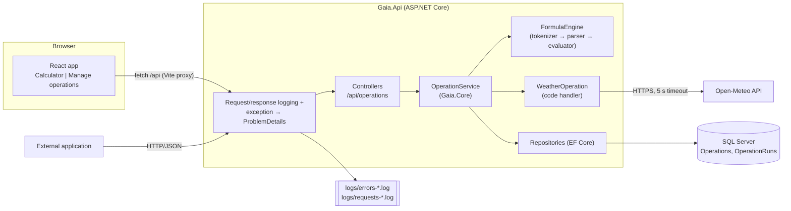

# Gaia Operations Platform: Plan

**Status:** Approved (2026-11-09)
**Spec:** [spec.md](spec.md) (approved 2026-11-09, incl. R13)

## Overview
An ASP.NET Core Web API holds all business logic. Most operations are **formulas stored as rows in SQL Server**, evaluated by a small, safe formula engine written for this project; the only code-backed operation is weather, which calls Open-Meteo. A React (JavaScript) app with two views, Calculator and Manage operations, talks to the API over HTTP, exactly like any external app.



## Technologies
| Layer | Choice | Why | Alternatives considered |
|---|---|---|---|
| Runtime | **.NET 10 (LTS)**, C# 14 | Required C#/.NET (C1). .NET 8 support ends 10 Nov 2026, so 10 is the current LTS. | .NET 8 (out of support tomorrow), .NET 9 (STS, ended May 2026) |
| API style | **ASP.NET Core controllers** | Most familiar shape for a C# backend developer; easy to explain line by line. | Minimal APIs (less ceremony, but routing logic spread through Program.cs) |
| API docs | **Swashbuckle (Swagger UI)** at `/swagger` | Lets the reviewer try every endpoint, incl. management, from a browser (R4.AC5). | Scalar, built-in OpenAPI doc only (no try-it UI) |
| Database | **SQL Server** — LocalDB in dev, Express/Developer via connection string | Spec C2 decision. | Oracle XE (heavier install) |
| Data access | **EF Core 10** + migrations | Schema as code, seed data in migrations, one command creates the DB (NFR3). | Dapper + SQL scripts (more hand-written SQL to maintain) |
| Formula engine | **Own recursive-descent parser** in `Gaia.Core/Formulas` (~250 lines) | Safe by construction — only the grammar and whitelisted functions exist (NFR6); no dependency to explain; the project's "creative" centrepiece (C9). | NCalc (less code, but a full expression language whose surface we'd have to restrict and explain) — **D1 decided 2026-11-09: own parser** |
| Operation model | **Two independent axes.** *Owner:* **system** (shipped, logic locked — rename/disable only) or **custom** (operator-created, fully editable/deletable). *Implementation:* **formula** (our engine) or **code handler** (a class implementing `IOperationHandler`, found by operation id). System ops `add subtract multiply divide power concat count` are locked formulas; `weather` is a locked code handler; `average`, `hypotenuse` and anything an operator adds are custom formulas. | Math rules (e.g. ÷0) live once, in the engine; system ops can't be broken by an edit; non-developers extend with formulas, developers extend by adding one handler class (plugin pattern). | All formulas, all editable (built-ins breakable); one C# class per operation (duplicated math rules, two code paths) — **D4 decided 2026-11-09: combine** |
| Weather | **Open-Meteo** forecast API via typed `HttpClient`, 5 s timeout. "Today" = today in the location's own time zone (`timezone=auto`). Result: one line, e.g. `Partly cloudy, 12–21 °C` (WMO weather code → text). | Free, no API key, no sign-up — the reviewer can run it as is. | OpenWeatherMap (needs key), weatherapi.com (needs key) |
| Numbers | `double`, results formatted `G15` invariant (`0.1 + 0.2` → `0.3`) | `sqrt`/`^` need floating point; G15 hides binary noise. | `decimal` (no `sqrt`/`pow`, mixed types) |
| DB availability | Any `DbException`/connection failure → **503** `database_unavailable`, written to the error log | Distinguishes "down" from "bug"; the UI shows "Service unavailable" (R5.AC5). | Generic 500 |
| Schema creation | The API applies EF migrations on startup in `Development` and `E2E` environments | The reviewer runs no DB commands (NFR3). | Manual `dotnet ef database update` |
| Management key (R13) | `[RequireManagementKey]` **authorization filter attribute** on the management actions; header `X-Management-Key`; compared with `CryptographicOperations.FixedTimeEquals` to config `Management:Key`. Dev key in `appsettings.Development.json` (documented); elsewhere set via env var `Management__Key`. Swagger gets an "Authorize" button for the header. UI keeps the key in `sessionStorage` (per tab). | Declarative and visible on each protected action; no path/method matching. Server-side only, so nothing secret reaches browser files (R13.AC6). Fixed-time compare avoids timing leaks. | Middleware matching paths + methods (protection rules hidden away from the actions); full ASP.NET authentication handler + policy (more framework to explain) |
| Starting the app | `scripts/run.ps1` starts the API and Vite, then opens the browser; README also lists the two manual commands | One command for the reviewer (NFR3). | Two terminals only; serving the built SPA from the API |
| Time | `TimeProvider` (built into .NET 8+) + `FakeTimeProvider` in tests | Deterministic month-boundary tests (R9.AC4). | `DateTime.UtcNow` directly (untestable) |
| Logging | **Serilog** with two filtered file sinks (JSON lines, daily rolling) + custom request/response middleware | Two separate logs as B.1.3 asks; middleware is ~60 readable lines and adds a correlation id shared by both logs (R11.AC2). | Built-in `HttpLogging` middleware (can't easily split files or correlate), DB log tables |
| Client | **React 19 + JavaScript (JSX) + Vite** | User decision (C3, 2026-11-09): plain JS keeps every client line easy to explain (C8); the component and E2E tests make up for the missing compile-time types. | TypeScript (types closer to C#, more syntax to explain) |
| Node.js | **Node 22 LTS, tooling only** (npm, Vite dev server, Vitest, Playwright) | React can't be built or served in dev without it. There is **no Node server**: the .NET API is the only backend, because the assignment puts all server logic in C#/.NET (C1, §2.2.1). | Node/Express BFF in front of .NET (extra backend, looks like breaking C1) |
| Client styling | One plain CSS file | Minimal UI is required; nothing to explain beyond CSS. | Tailwind, MUI (more to learn/explain) |
| Unit tests (server) | **xUnit** + built-in `Assert` | .NET default; no licence questions. | NUnit, FluentAssertions (v8 is commercial) |
| Integration tests | **xUnit + `WebApplicationFactory`** against a real **LocalDB** test database, weather stubbed with a fake `HttpMessageHandler` | Same engine as production; no Docker on this machine. | Testcontainers (needs Docker), EF InMemory/SQLite (different engine) |
| Component tests | **Vitest + React Testing Library**, fake API client | Vite-native, fast. | Jest |
| E2E | **Playwright** (4 tests) against the running app with the weather provider set to `Fake` | Proves the real flows a reviewer will click. | None (component + integration only) — **D2 decided 2026-11-09: Playwright, 4 tests** |
| Repo / CI | Private GitHub repo; **GitHub Actions** runs unit + component tests on every push (S11) | Visible quality signal at low cost; integration/E2E stay local because they need SQL Server. | No CI — **D3 decided 2026-11-09: include CI** |

## Data model
| Entity | Fields | Relations | Step |
|---|---|---|---|
| **Operation** | `Id` string(50) PK, slug, e.g. `divide` · `Name` string(100) · `Kind` enum Arithmetic/String/Other · `FieldALabel`, `FieldBLabel` string(50) · `InputType` enum Number/Text/Coordinate · `Formula` string(500) null (null ⇒ code handler) · `IsSystem` bool · `IsEnabled` bool · `IsDeleted` bool · `CreatedAtUtc`, `UpdatedAtUtc` datetime2 · `Version` rowversion (EF concurrency token, R4.AC7) | 1 → * OperationRun | S3 |
| **OperationRun** | `Id` bigint identity PK · `OperationId` FK · `FieldA`, `FieldB` string(200) · `Result` string(1000) null · `IsSuccess` bool · `ErrorCode` string(50) null · `ErrorMessage` string(500) null · `CreatedAtUtc` datetime2 · `DurationMs` int · index (`OperationId`, `IsSuccess`, `CreatedAtUtc` desc) | * → 1 Operation (Restrict) | S8 |

- **Delete is soft** (`IsDeleted = true`): the row and its history stay (R4.AC3); a deleted id can't be reused (avoids history mixing two different operations).
- **"Built-in" (spec term) = `IsSystem = true`.** System operations accept name/label/enabled changes only and can't be deleted (R4.AC6). `Formula IS NULL` ⇒ a code handler must be registered for the id (checked at startup; a missing handler fails fast).
- **Seed** (migration): system formulas `add` = `A + B`, `subtract`, `multiply`, `divide` = `A / B`, `power` = `A ^ B` (arithmetic, Number) · `concat` = `concat(A, B)`, `count` = `count(A, B)` (string, Text) · system code handler `weather` (other, Coordinate) · custom formulas `average` = `(A + B) / 2`, `hypotenuse` = `sqrt(A*A + B*B)`.

## Contracts

### Formula language (S2)
- Values: **number** (double), **text**, **bool**. `A` and `B` are parsed by the operation's `InputType`: Number → number (invariant culture, `.` decimal, R3.AC5), Text → text, Coordinate → number with range check (lat −90…90 for A, lon −180…180 for B).
- Literals: `12`, `3.5`, `"text"`. Operators by precedence: `( )` · unary `-` · `^` (right-assoc) · `* / %` · `+ -` · `== != < <= > >=`. `+` adds two numbers or concatenates two texts; mixing → type error.
- Whitelisted functions: `sqrt abs round(x[,digits]) min max floor ceil` · `upper lower len trim concat replace(s, find, with) contains(s, part) count(s, part)` · `if(cond, then, else)`.
- Anything else — unknown identifier, function, wrong arity — is a **parse error at save time** (R4.AC4) with position: `Unknown function 'File' at position 1`.
- Runtime **domain errors**: division or modulo by zero, a NaN/∞ result, a type mismatch. Numbers are formatted with `G15`, invariant culture (so `0.1 + 0.2` → `0.3`).
- Limits: formula ≤ 500 chars, parse depth ≤ 50 (no stack overflow from `((((…`).

### API (all JSON, base `/api`)
| Endpoint | Input | Output | Errors | Step |
|---|---|---|---|---|
| `GET /operations` | `?includeDisabled=true` (management list, **key required**; also used by the UI to check a key) | `OperationDto[]` — enabled, non-deleted by default | 401 `unauthorized` (includeDisabled only) | S4 (filter param S6, key S12) |
| `POST /operations/{id}/execute` | `{ fieldA, fieldB }` | `ExecuteResponse` | 400 validation · 404 not found · 422 domain · 502/504 external | S4 |
| `POST /operations` | `OperationUpsertDto` | 201 + `OperationDto` | 400 validation/formula · 409 duplicate id | S6 |
| `PUT /operations/{id}` | `OperationUpsertDto` incl. `version` | `OperationDto` (new `version`) | 400 · 404 · 400 `system_logic_readonly` · 409 `edit_conflict` | S6 |
| `DELETE /operations/{id}` | — | 204 | 404 · 400 `system_cannot_delete` | S6 |

Any endpoint may also return **503** `database_unavailable`. POST, PUT, DELETE and `GET ?includeDisabled=true` require `X-Management-Key` and return **401** `unauthorized` without a valid one (S12).

```text
// JSON shapes (C# records on the server; plain objects in the JS client)
OperationDto        { id, name, kind: "Arithmetic"|"String"|"Other", fieldALabel, fieldBLabel,
                      inputType: "Number"|"Text"|"Coordinate", formula: string|null, isSystem, isEnabled,
                      version: string }   // base64 of the rowversion
OperationUpsertDto  { id, name, kind, fieldALabel, fieldBLabel, inputType, formula?, isEnabled,
                      version? }          // required on PUT, ignored on POST
ExecuteResponse     { operationId, fieldA, fieldB, result: string,
                      history: { previousRuns: RunDto[], monthCount: number } | null }   // null until S8, or if history store failed (R7.AC3)
RunDto              { fieldA, fieldB, result, createdAtUtc }
```

- **Errors** are RFC 7807 `ProblemDetails` with an extra machine-readable `code` (R2.AC6): `validation_error`, `operation_not_found`, `formula_invalid`, `duplicate_id`, `system_logic_readonly`, `system_cannot_delete`, `edit_conflict`, `unauthorized`, `domain_error`, `external_service_error`, `external_service_timeout`, `database_unavailable`, `internal_error`; plus `field` when it applies and `correlationId`.
- Every response carries an `X-Correlation-Id` header (S9).
- History block for an execute is computed **after** the current run is stored: `previousRuns` = 3 most recent successful runs of the same operation excluding the current run (A5, A9); `monthCount` = successful runs of the operation since the 1st of the current month 00:00 Asia/Jerusalem, including the current run (A7).

### Shared names (server)
`Gaia.Core`: `OperationDefinition`, `IOperationRepository`, `IRunRepository`, `IOperationHandler` (code ops), `OperationService`, `FormulaEngine` / `FormulaParser` / `Tokenizer` / `Evaluator`, `GaiaException` (+ `ValidationException`, `NotFoundException`, `DomainException`, `ExternalServiceException`, `ConflictException`), `IsraelMonth.StartUtc(TimeProvider)`.
`Gaia.Infrastructure`: `GaiaDbContext`, `EfOperationRepository`, `EfRunRepository`, `OpenMeteoWeatherHandler`, `FakeWeatherHandler`.
`Gaia.Api`: `OperationsController`, `ProblemDetailsMapper`, `RequestResponseLoggingMiddleware`, `CorrelationIdMiddleware`.

### Shared names (client)
`src/api/errors.js` (`ApiError`, `ServiceUnavailableError`) · `src/api/httpApi.js` · `src/api/fakeApi.js` (both export the same functions: `getOperations`, `execute`, `createOperation`, `updateOperation`, `deleteOperation`) · `src/api/ApiContext.jsx` (lets tests inject `fakeApi`) · `src/views/CalculatorView.jsx` · `src/views/ManageView.jsx` · `src/components/HistoryPanel.jsx` · `src/components/OperationForm.jsx` · `src/App.jsx` (view switch).

### Screens
- **Calculator** (default): `Field A [label]` · operation `<select>` · `Field B [label]` · **Calculate** · result box · error box · history panel (S8).
- **Manage operations**: table (name, id, kind, labels, formula or "built-in", enabled toggle, Edit, Delete) · "Add operation" button → `OperationForm` (inline panel) · server error shown in the form.
- Switch: a top bar with two buttons; one `useState` in `App.jsx`, no router. The calculator re-fetches the catalog every time it becomes visible (R12.AC7).

### File ownership
| Folder / file | Owning step | Also modified by |
|---|---|---|
| `Gaia.sln`, `Directory.Build.props`, `README.md`, `.gitignore`, `scripts/`, test project scaffolds, `client/` scaffold (Vite config, package.json, `main.jsx`) | S1 | README sections: S10 |
| `src/Gaia.Core/Formulas/**` | S2 | — |
| `src/Gaia.Core/Operations/**`, `src/Gaia.Core/Errors/**` | S2 (errors, definitions) | — |
| `src/Gaia.Infrastructure/Data/GaiaDbContext.cs`, `Data/Migrations/**` (Operation), `Data/EfOperationRepository.cs` | S3 | S8 adds the OperationRun entity + migration |
| `src/Gaia.Core/Services/OperationService.cs`, `src/Gaia.Infrastructure/Weather/**`, `src/Gaia.Api/Program.cs`, `Controllers/OperationsController.cs`, `Errors/ProblemDetailsMapper.cs` | S4 | S6 (management actions), S8 (history), S9 (logging registration) |
| `src/Gaia.Core/Services/CatalogService.cs` (create/update/delete rules) | S6 | — |
| `src/Gaia.Core/History/**`, `src/Gaia.Infrastructure/Data/EfRunRepository.cs` | S8 | — |
| `src/Gaia.Api/Logging/**`, `serilog` config in `appsettings.json` | S9 | — |
| `client/src/api/**`, `client/src/App.jsx`, `client/src/views/CalculatorView.jsx`, `client/src/styles.css` | S5 | S7 (App switch, fake API management calls), S8 (render HistoryPanel) |
| `client/src/views/ManageView.jsx`, `client/src/components/OperationForm.jsx` | S7 | — |
| `client/src/components/HistoryPanel.jsx` | S8 | — |
| `src/Gaia.Api/Security/**` (`RequireManagementKeyAttribute`, `ManagementKeyOptions`), `appsettings.Development.json` `Management` section | S12 | — |
| `client/src/components/KeyGate.jsx` | S12 | — |
| `client/e2e/**`, `playwright.config.js` | S10 | — |
| `.github/workflows/**` | S11 | — |

Where a step modifies a file it doesn't own, the change is additive (a new method, a DI registration, one rendered component) and is listed in that step's outline.

## Test strategy
Test names start with the AC id, e.g. `R2_AC5_divide_by_zero_returns_domain_error` (xUnit) or `it("R5.AC4: shows the server error")` (Vitest/Playwright).

| AC | Unit | Integration | Component / E2E | Notes |
|---|---|---|---|---|
| R1.AC1 | | ✔ GET returns seeded ops with id, name, kind, labels | E2E: dropdown filled | |
| R1.AC2 | | ✔ disabled/deleted op absent | | |
| R1.AC3 | | ✔ all disabled → `[]`, 200 | | |
| R2.AC1 | ✔ service returns result | ✔ POST execute → 200 + result | E2E: calculate 7 ÷ 2 | |
| R2.AC2 | ✔ | ✔ unknown & disabled → 404 `operation_not_found` | | |
| R2.AC3 | ✔ | ✔ missing fieldA → 400, `field: "fieldA"` | | |
| R2.AC4 | ✔ parse "abc" as Number, lat 95 | ✔ 400 `validation_error` | | |
| R2.AC5 | ✔ ÷0, %0, sqrt(−1) | ✔ 422 `domain_error` | | |
| R2.AC6 | | ✔ each error kind has distinct `code` | | table-driven test |
| R3.AC1 | ✔ 7,2 → 9, 5, 14, 3.5, 49 (seeded formulas through engine) | | | |
| R3.AC2 | ✔ concat, count | | | |
| R3.AC3 | ✔ handler maps Open-Meteo JSON → "Partly cloudy, 12–21 °C" | ✔ execute weather with stubbed HTTP | | |
| R3.AC4 | ✔ handler: 500, timeout, bad JSON → ExternalServiceException | ✔ 502/504 + code | | |
| R3.AC5 | ✔ "-2.5" and "10" accepted; "3,5", "1e3" and "abc" rejected | | | |
| R4.AC1 | | ✔ POST then GET + execute, same host, no restart | E2E: add "average2", use it | |
| R4.AC2 | | ✔ PUT formula → next execute uses it | | |
| R4.AC3 | | ✔ DELETE → absent + 404 on execute; runs still in DB | | |
| R4.AC4 | ✔ parser errors with position | ✔ 400 `formula_invalid`, 409 `duplicate_id`; catalog unchanged | | |
| R4.AC5 | | ✔ Swagger JSON lists POST/PUT/DELETE | | |
| R4.AC6 | ✔ CatalogService rules | ✔ PUT formula on `divide` or `weather` → 400 `system_logic_readonly`; rename + disable succeed | | |
| R4.AC7 | | ✔ two PUTs with the same `version` → first 200, second 409 `edit_conflict`; DB holds first values; PUT with fresh version → 200 | | real SQL Server rowversion |
| R5.AC1 | | | Component: select options = fake catalog | |
| R5.AC2 | | | Component: labels change on select | |
| R5.AC3 | | | Component + E2E | |
| R5.AC4 | | | Component: problem `detail` shown, no result | |
| R5.AC5 | | | Component: fetch rejects → "Service unavailable" | |
| R6.AC1 | | | Component: shown result == fake API value (fake returns a value no client math would produce) | |
| R6.AC2 | | ✔ same inputs via HTTP == service result | | |
| R12.AC1 | | | Component: switch views both ways | |
| R12.AC2 | | | Component: disabled ops listed, "built-in" shown | |
| R12.AC3 | | | Component + E2E | |
| R12.AC4 | | | Component: system op → formula/kind/input-type read-only | |
| R12.AC5 | | | Component: toggle calls API, row updates | |
| R12.AC6 | | | Component: 400 `formula_invalid` → message + inputs kept | |
| R12.AC7 | | | Component: catalog re-fetched on return; E2E | |
| R12.AC8 | | | Component: 409 `edit_conflict` → message + inputs kept; Reload re-fetches the op | |
| R13.AC1 | | ✔ POST/PUT/DELETE with no key and wrong key → 401 `unauthorized`; catalog unchanged | | |
| R13.AC2 | | ✔ same calls with the key → as R4 (all R4 integration tests send the key) | | |
| R13.AC3 | | ✔ GET (enabled) and execute succeed without a key | | |
| R13.AC4 | | | Component: KeyGate locked → wrong key shows "Invalid management key"; right key unlocks; E2E unlocks before adding a formula | |
| R13.AC5 | | | Component: key read from `sessionStorage`; Lock clears it | |
| R13.AC6 | ✔ client build output (`client/dist`) and `src/**` contain no configured key value | | | scan in Vitest after build, or a script in `test-all.ps1` |
| R13.AC7 | | ✔ request with a key → request log has `X-Management-Key: ***`, the key text appears in no sink | | built with S9 |
| R13.AC8 | | ✔ factory with empty `Management:Key` → 401 even with a header; startup warning logged | | |
| R7.AC1 | | ✔ execute (success and failure) stores a row with all fields | | |
| R7.AC2 | | ✔ new factory instance reads old rows | | "restart" = new host, same DB |
| R7.AC3 | ✔ run repo throws → result still returned, history null, error logged | | | |
| R8.AC1 | | ✔ 4 prior runs → 3 newest prior, current excluded | E2E: history panel visible | |
| R8.AC2 | | ✔ 0 and 2 prior runs | Component: "No previous runs" | |
| R8.AC3 | | ✔ other ops' runs excluded | | |
| R8.AC4 | | ✔ history in API response | | |
| R8.AC5 | | ✔ failed runs excluded | | |
| R9.AC1 | | ✔ N this month + M last month → N | | FakeTimeProvider |
| R9.AC2 | | ✔ other ops / failed not counted | | |
| R9.AC3 | | ✔ count in API response | | |
| R9.AC4 | ✔ `IsraelMonth.StartUtc` at 1st 00:30 IL = previous day 21:30/22:30 UTC | | | DST both sides |
| R10.AC1 | | ✔ throwing endpoint → error log entry with stack + correlation id; client body has no stack | | test sink |
| R10.AC2 | | ✔ 400/404/422 produce no error-log entry | | |
| R11.AC1 | | ✔ one entry per request with all fields | | test sink |
| R11.AC2 | | ✔ same correlation id in both logs | | |
| NFR2 | ✔ handler times out at 5 s (fake clock/handler) | | | |
| NFR5 | ✔ source scan finds `// A34D` in `src/Gaia.Api` | | | |
| NFR6 | ✔ `File.Delete("x")`, `System.IO…`, `A.GetType()` → parse error | | | |

**Test tools:** xUnit · `Microsoft.AspNetCore.Mvc.Testing` · `Microsoft.Extensions.TimeProvider.Testing` · Serilog `InMemory` sink · Vitest + `@testing-library/react` + jsdom · Playwright.

**Test commands:**
| Level | Command |
|---|---|
| Unit (server) | `dotnet test tests/Gaia.Core.Tests` |
| Integration (server, needs LocalDB) | `dotnet test tests/Gaia.Api.Tests` |
| Component (client) | `npm --prefix client test -- --run` |
| E2E | `npm --prefix client run e2e` |
| All | `pwsh scripts/test-all.ps1` |

Integration tests create a uniquely named LocalDB database per test class (`GaiaTests_<guid>`), apply migrations, and drop it afterwards; tests within a class clean their own rows.

## Build steps

### S1 · Project setup   (Must) · ~1 h
- **Delivers:** foundation for all; NFR3 (skeleton)
- **Depends on / Unblocks:** prerequisites installed (.NET 10 SDK, Node 22 LTS, SQL Server LocalDB, git) / everything
- **Files owned:** solution, 3 src + 2 test projects, `client/` Vite React (JavaScript) scaffold (trimmed of demo code), `scripts/run.ps1`, `scripts/test-all.ps1`, `README.md` skeleton, `.gitignore`
- **Outline:** `git init`; one passing smoke test per level (xUnit unit, WebApplicationFactory `GET /health`→200 deleted later, Vitest render, Playwright opens page); Vite proxy `/api` → `http://localhost:5080` (plain HTTP in dev so neither Vite nor Playwright needs the dev certificate trusted).
- **Done when:** all five test commands run green.

### S2 · Formula engine + error types   (Must) · ~2.5 h
- **Delivers:** R2.AC4, R2.AC5, R3.AC1, R3.AC2, R3.AC5, NFR6 (also provides `FormulaEngine.Validate`, used by S6 for R4.AC4)
- **Depends on / Unblocks:** S1 / S3, S4, S6
- **Files owned:** `Gaia.Core/Formulas/**`, `Gaia.Core/Errors/**`, `Gaia.Core/Operations/OperationDefinition.cs`, `InputParser.cs`
- **Outline:** `Tokenizer` → tokens with positions; `FormulaParser` (recursive descent, depth limit) → AST records (`NumberNode`, `TextNode`, `VarNode`, `UnaryNode`, `BinaryNode`, `CallNode`); `Evaluator` walks the AST with `Value` (number/text/bool); `Functions` dictionary name → (arity, delegate). `FormulaEngine.Validate(formula)` and `Evaluate(formula, a, b)`.
- **Done when:** unit tests for every operator, function, error and the NFR6 cases pass.

### S3 · Data layer   (Must) · ~0.75 h
- **Delivers:** persistence for R1/R4 (tested through S4/S6)
- **Depends on / Unblocks:** S2 / S4
- **Files owned:** `GaiaDbContext`, `Operation` entity config, initial migration with seed, `EfOperationRepository`
- **Outline:** `dotnet ef migrations add Initial`; app applies migrations on startup in Development (NFR3).
- **Done when:** integration smoke test: migrated test DB returns the 10 seeded operations.

### S4 · Catalog + execute API, weather   (Must) · ~2 h
- **Delivers:** R1.AC1–3, R2.AC1–3, R2.AC6, R3.AC3–4, R6.AC2, NFR2, NFR5
- **Depends on / Unblocks:** S3 / S5, S6, S8, S9
- **Files owned:** `OperationService`, `IOperationHandler`, `OpenMeteoWeatherHandler`, `FakeWeatherHandler`, `OperationsController` (GET, execute), `ProblemDetailsMapper`, `Program.cs` (with `// A34D` comment), Swagger setup
- **Outline:** service loads the definition → not found if missing/disabled/deleted → parse inputs by `InputType` → formula ⇒ engine, else ⇒ handler by id → map exceptions to ProblemDetails + `code` (DB failures → 503 `database_unavailable`). Startup check: every system op with no formula has a registered handler. Migrations auto-applied in Development/E2E. `IRunRecorder` with a no-op implementation (replaced in S8). `Weather:Provider` = `OpenMeteo` | `Fake`.
- **Done when:** integration tests for the listed ACs pass; Swagger UI loads.

### S5 · React calculator   (Must) · ~1.5 h
- **Delivers:** R5.AC1–5, R6.AC1
- **Depends on / Unblocks:** S1 (can start in parallel with S2–S4 using `fakeApi`) / S7, S10
- **Files owned:** `client/src/api/**`, `App.jsx`, `CalculatorView.jsx`, `styles.css`
- **Outline:** `httpApi` and `fakeApi` export the same functions, chosen through `ApiContext`; `httpApi` maps non-2xx to `ApiError { code, detail, field }` and network failure to `ServiceUnavailableError`; form state with `useState`; labels from selected op.
- **Done when:** component tests pass against `fakeApi`; manual check against the real API.

### S6 · Management API   (Should) · ~1.75 h
- **Delivers:** R4.AC1–7
- **Depends on / Unblocks:** S4 / S7
- **Files owned:** `CatalogService`; adds POST/PUT/DELETE + `includeDisabled` to `OperationsController`
- **Outline:** validate id slug `^[a-z][a-z0-9-]{1,49}$`, required fields, formula via `FormulaEngine.Validate`; duplicate (incl. soft-deleted) → 409; system-operation rules; new operations are always custom (`IsSystem` can't be set through the API). PUT sets the client's `version` as the original concurrency value; EF's `DbUpdateConcurrencyException` → 409 `edit_conflict`.
- **Done when:** integration tests for R4 pass.

### S7 · Manage operations view   (Should) · ~1.75 h
- **Delivers:** R12.AC1–8
- **Depends on / Unblocks:** S5, S6 (contract only; can use `fakeApi`) / S10
- **Files owned:** `ManageView.jsx`, `OperationForm.jsx`; adds the view switch to `App.jsx` and management calls to the API client + fake
- **Done when:** component tests pass.

### S12 · Management key   (Should) · ~1 h — built right after S7, before S8
- **Delivers:** R13.AC1–6, R13.AC8
- **Depends on / Unblocks:** S6, S7 / S8, S9, S10
- **Files owned:** `Gaia.Api/Security/**`, `KeyGate.jsx`, `Management` config section; adds `[RequireManagementKey]` to the management actions, the Swagger security definition in `Program.cs`, the header in `httpApi.js`, and wraps `ManageView` in `KeyGate`
- **Outline:** filter reads `X-Management-Key`, compares in fixed time to `ManagementKeyOptions.Key`; empty config ⇒ always 401 + startup warning. `KeyGate` shows a password field, checks the key with `GET ?includeDisabled=true`, stores it in `sessionStorage`, offers "Lock".
- **Done when:** integration + component tests for R13 pass; existing R4/R12 tests updated to send the key.

### S8 · History, last 3, monthly count   (Could) · ~1.75 h
- **Delivers:** R7.AC1–3, R8.AC1–5, R9.AC1–4
- **Depends on / Unblocks:** S4 / S10
- **Files owned:** `Gaia.Core/History/**` (`IRunRepository`, `HistoryService`, `IsraelMonth`), `EfRunRepository`, `OperationRun` entity + migration, `HistoryPanel.jsx`; swaps `IRunRecorder` registration; `CalculatorView` renders `<HistoryPanel>`
- **Outline:** after execute (success or failure) store the run; on success read history; any history exception → log error, return `history: null` (R7.AC3).
- **Done when:** integration + unit tests for R7–R9 pass.

### S9 · Server logs   (Could) · ~1 h
- **Delivers:** R10.AC1–2, R11.AC1–2, R13.AC7 (the `X-Management-Key` header is masked as `***` before logging)
- **Depends on / Unblocks:** S4 / S10
- **Files owned:** `Gaia.Api/Logging/**`, Serilog config
- **Outline:** `CorrelationIdMiddleware` (reads or creates `X-Correlation-Id`, pushes it to the Serilog `LogContext`); `RequestResponseLoggingMiddleware` (buffers request body, swaps the response stream, logs method/path/bodies (truncated at 16 KB)/status/duration to `logs/requests-.log`); unhandled exceptions → `logs/errors-.log` with stack; `GaiaException`s are not logged as errors.
- **Done when:** integration tests with an in-memory sink pass; files appear under `logs/`.

### S10 · E2E + README + submission   (Must for README; E2E per D2) · ~1.5 h
- **Delivers:** NFR3; E2E rows in the test strategy
- **Depends on / Unblocks:** S5 (and S7, S8 if done) / submission
- **Files owned:** `client/e2e/**`, `playwright.config.js`; README final sections (setup, run, API examples with curl, formula language reference, interpretations A5/A8/A9, known limitations: no auth, LocalDB on Windows)
- **Outline:** 4 tests: calculate 7 ÷ 2 = 3.5 · divide by zero shows error · add a formula in Manage, use it in Calculator · history panel shows previous run. Playwright `webServer` starts the API (`ASPNETCORE_ENVIRONMENT=E2E`, fake weather, fresh DB) and Vite.
- **Done when:** E2E green; a fresh clone follows the README to a working app.

### S11 · CI   (Should — user decision D3) · ~0.5 h
- **Delivers:** nothing in the spec; quality signal
- **Files owned:** `.github/workflows/ci.yml` — unit + component tests on push (integration/E2E stay local because they need SQL Server).

**Budget:** Must S1–S5 + S10 = **9.25 h** · + Should S6, S7, S12, S11 = **14.25 h** · + Could S8–S9 = **17.25 h**. That's ~1.25 h over the original 12–16 h budget (C11); **the user accepted 17.25 h with everything in, CI included (2026-11-09).** Build order: S1→S5, S6, S7, S12, S8, S9, S10, S11.

## Traceability
| R# | Steps | Test levels |
|---|---|---|
| R1 | S4 (S6 adds `includeDisabled`) | Integration, E2E |
| R2 | S2, S4 | Unit, Integration, E2E |
| R3 | S2 (formulas), S4 (weather) | Unit, Integration |
| R4 | S6 (S2 for the parser) | Unit, Integration, E2E |
| R5 | S5 | Component, E2E |
| R6 | S5, S4 | Component, Integration |
| R12 | S7 | Component, E2E |
| R13 | S12 (AC7 in S9) | Unit, Integration, Component, E2E |
| R7 | S8 | Unit, Integration |
| R8 | S8 | Integration, Component, E2E |
| R9 | S8 | Unit, Integration |
| R10 | S9 | Integration |
| R11 | S9 | Integration |
| NFR2, NFR5, NFR6 | S4, S4, S2 | Unit |
| NFR3 | S1, S10 | Manual (verify phase, fresh clone) |
| NFR1, NFR4 | all | Manual (verify phase) |

## Risks
| Risk | Likelihood | Mitigation |
|---|---|---|
| Reviewer has Visual Studio 2022, which doesn't support .NET 10 | Medium | README states VS 2026 or `dotnet` CLI; `run.ps1` works without VS. Fallback: retarget to .NET 8 is a one-line change (no .NET 10-only APIs used). |
| Reviewer has no LocalDB | Medium | Connection string in `appsettings.json` + README line for SQL Express; app applies migrations itself. |
| Open-Meteo down or rate-limited during review | Low | R3.AC4 error path; `Weather:Provider=Fake` documented. |
| Formula engine edge cases (precedence, unary minus, `^` associativity) | Medium | Table-driven unit tests written first (S2). |
| Concurrent edits of the same operation | Low | Optimistic concurrency with a SQL Server `rowversion` (R4.AC7, R12.AC8): stale saves get 409, never a silent overwrite; no locks to get stuck. |
| Over budget | Medium | Must steps first; S8/S9/S11 are independent and can be dropped one by one. |
| Dev management key committed in `appsettings.Development.json` | Certain (by design) | Dev-only value, documented as such; README shows setting `Management__Key` via env var for anything else; production config has no key ⇒ closed (R13.AC8). |
| Explaining every line (C8) | — | Small files, no generated boilerplate left in; README "How it works" section. |

## Submission notes
<Filled in at the end.>
